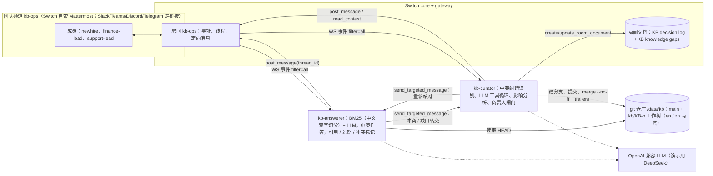

# KB Steward：让两个 Agent 在团队群聊里把知识库改对

*Flip the Switch 黑客松（WeMakeDevs × DevTools Academy × Switch，Track 01）个人参赛作品。英文原文见文末链接。*

## 问题：知识库总在悄悄「漂移」

几乎每个团队的知识库都有一部分是错的，只是没人发现。

场景很熟悉：新同事在群里问「出差餐补多少？」，有人（或者机器人）照着一篇旧文档回答「每天 ¥100」。这时财务负责人补一句：「早改了，11 月起是 ¥120。」大家点个赞，消息很快被刷上去——**文档本身一个字都没改**。下周，同样的错误答案又出现了。

基于文档做问答的 AI 机器人会让情况更糟：它会非常自信地复述过期内容，却从不负责修正。

在企业里这不是小问题：制度更新了，执行口径却还停在旧版本；两份文档互相矛盾，一线员工只能「凭感觉选一个」。

所以这次黑客松我做了 **KB Steward**：两个通过 [Switch](https://github.com/sandbox-quantum/switch) 接入团队频道的 Agent，把群聊里随口的一句纠正，变成**经过审核的文档变更**，而文档负责人始终握有最终决定权。

- 📺 演示视频（英文，1:58）：https://youtu.be/8xKwF6o_T2U
- 💻 代码仓库（MIT）：https://github.com/breeze-lyf/kb-steward （[中文 README](https://github.com/breeze-lyf/kb-steward/blob/main/README.zh-CN.md)）

> 仓库与截图中的公司数据全部是虚构示例（「Northwind Example Co.」/「北风示例公司」），人物均为演示角色：`newhire`（新员工）、`finance-lead`（财务负责人）、`support-lead`（客服负责人）。

## 一个闭环讲清楚它做什么

同一个 Switch 房间 `kb-ops` 里有两个 Agent：

1. **`@kb-answerer`（答疑员）**：*只*依据 git 管理的知识库回答问题，中文问就中文答、英文问就英文答。每条回答都附带引用、文档负责人和最近复核日期。超过一年没复核的文档标 **⚠️ 过期**；两份文档说法不一致时标 **冲突**，并且不瞎猜，直接转交给管理员。
2. **`@kb-curator`（管理员）**：旁听整个房间。一旦有人*纠正*了某个回答——不需要 @ 它——它就在知识库上跑一个带工具调用的循环（`search_kb` / `grep` / `read_file` / `write_file`），找出**所有**写着错误事实的文档，在独立分支 `kb/KB-n` 上提交修改，附上**影响分析**，用该分支**预览新答案**，再把 diff 作为提案 **KB-n** 发回线程。
3. **只有文档负责人能批准**（`approve KB-n` 或 `批准 KB-n`）。批准后以 `Approved-by:` / `Requested-by:` / `Impact:` git trailer 合并，重建索引，在 Switch 房间文档 **「KB decision log」（决策日志）** 追加一行，并把最初的问题交还给答疑员，在同一线程里重新作答。


英文版录制中，新员工问餐补。回答是「每天 $50」，引用 `finance/expense-policy.md`（⚠️ 已 967 天未审）和 `finance/travel-faq.md`（⚠️ 653 天）。随后 `finance-lead` 在线程里回了一句：*「过时了，7 月起是每天 $65，超过 $25 需要票据。」* 没人 @ 管理员，但它照样发出了 KB-1——**改了两个文件**，因为 FAQ 也抄了旧数字。这正是人工维护最容易漏的地方。


## 架构



技术栈：Switch 0.31.0（core、gateway 和自带的 Mattermost 桥）、一千多行 Python 3.12（`httpx`、`websockets`）、git worktree、基于 Markdown 的段落级 BM25 索引，以及任意 OpenAI 兼容的对话接口，全部用 Docker Compose 编排。

最关键的设计取舍：**我的代码不直接调用 Mattermost 的任何接口**，所有读写都走 Switch 的 Agent 协议。所以在 Switch gateway 里接上对应桥接后，这两个进程理论上无需改代码就能跑在 Slack、Teams、Discord 或 Telegram 上。（录制选 Mattermost，是因为它完全自托管，谁都能复现。）

## 接入 Switch：协议要点

Switch 的模式可以概括为「事件从 WebSocket 进来，操作通过 HTTP 发出去」。整个客户端就是 `agents/switch_proto.py`，不到 200 行。真正关键的是下面几点。

### 1. 注册一次，身份持久化

每个 Agent 用部署的注册 token 调 `POST /agents`，拿到 `id` 和 `api_key`，保存到本地（chmod 600），重启时复用——这样它在频道里的名字和头像都保持不变。

### 2. 事件流开 `filter=all`

这是管理员能存在的前提。开了 `filter=all`，Agent 能收到房间里的*每一条*消息，而不只是 @ 它的那些。事件循环要对每个 `ping` 回带游标的 `pong`，处理 `gap` 和 `evicted`，断线退避重连。早早学到的一条铁律：**永远别让模型调用阻塞心跳**，处理函数一律丢进独立 task：

```python
if frame.get("event") == "message":
    data = frame["data"]
    self.cursor = frame.get("id", self.cursor)
    # 不要让模型调用阻塞 ping
    asyncio.create_task(self._safe(on_message, data, data.get("payload", {})))
```

### 3. 「被叫到」和「旁听到」

每个事件都带 `addressed` 标记，两个 Agent 用法正好相反：答疑员「有礼貌」，只有被 @ 才说话；管理员「旁听」，被 @、消息命中纠错关键词（中英文都有）、或者是它正在等负责人回复的线程时才介入——即便如此，还要再过一道 LLM 分类器，确认这真的是一次纠正：

```python
if not (p.get("addressed") or HINT.search(body) or thread in pending):
    return
context = await thread_text(thread)          # Switch 操作 read_context
verdict = await classify(strip_mentions(body), context)
```

### 4. 一律线程内回复

所有回复都通过 `post_message(body, thread_id)` 留在提问的那个线程里，整个闭环从上往下读一遍就清楚。

### 5. Agent 之间用 `send_targeted_message` 交接

答疑员发现冲突或答不上时不猜，按名字转交管理员；合并完成后，管理员用同一个操作反向通知答疑员「重新核对」：

```python
await agent.op("send_targeted_message", target_names=["kb-curator"], thread_id=thread,
               body=f"hand-off · CONFLICT · {conflict.get('summary','')} · files: {', '.join(cites)} · question: {q}")
```


### 6. 房间文档做审计日志

git 里有完整历史，但群里的同事不该为了看「改了什么」去开终端。所以管理员维护所有成员和 Agent 都能读的 Switch 房间文档：「KB decision log」记录决策，「KB knowledge gaps」记录知识缺口。首次用 `create_room_document` 创建，之后用 `update_room_document` 更新。此外，bootstrap 用 `create_room` 建房间（房间说明中英双语），并设置 gateway 的寻址策略让任何成员都能 @ Agent；模型思考时调 `POST /agents/{id}/typing` 显示「正在输入」。

## 治理：人审 + 审计，限制必须写在代码里

我的原则是：**AI 干脏活累活（影响面分析、多文件修改、结果验证），人保留决定权。**

系统提示词里写一句「只允许负责人批准」不算管控——模型是可以被说服的。所以每条关键限制都是普通的 Python 代码：

**负责人闸门。** 每篇文档 front matter 里有 `owner:` 字段，环境变量把负责人映射到聊天账号（如 `APPROVERS=finance:finance-lead;support:support-lead`）。审批人身份取自 Switch 事件里的 `sender_name`，来自聊天平台本身，而不是模型的判断。演示里客服负责人试图批准财务文档的修改，被直接拒绝：「只有 @finance-lead 能签字，未合并任何内容。」


**合并就是普通的 git merge。** `merge --no-ff` 加 `Approved-by` / `Requested-by` / `Impact` trailer，任何人都能用 `git log` 审计、用 `git revert` 回滚。

**编辑工具有围栏。** 管理员的 `write_file` 只能改提案自己 worktree 里**已存在**的 `.md` 文件，且只能改与更正同语言的知识库，其他路径一律拒绝。没有负责人批准，任何改动都进不了 `main`。


英文演示中 KB-1 合并为 `f7f2723`，索引重建为 7 篇文档 27 个段落，答疑员在同一线程重新回答「每天 $65……超过 $25 需留票据」。退款冲突同理：`support-lead` 一句「30 天是对的，话术模板错了」，变成 KB-2，合并为 `99ba48b`。


我想强调的治理观点是：**企业知识库的问题从来不是「AI 能不能写」，而是「谁有权改、改了会影响什么、改了能不能追溯」。** 让 AI 发起变更、让人拍板、让每次决策同时留在 git 和群里，这才是能在企业里落地的形态。

## 中文与治理加深

黑客松提交之后，我在 commit `76e0b84` 里把项目往两个方向加深了一步：**让中文团队能直接用起来**，以及**让治理从「能审批」变成「看得清影响、补得上缺口、管得住过期」**。以下内容都已在仓库中实现。

### 中文：不是翻译界面，而是从头到尾都支持中文

- **中问中答，英问英答。** 按提问的语言作答，引用标签（负责人、复核日期、过期提示、置信度）也跟着本地化。
- **中文检索。** 英文按词切分；中文连续字符切成双字（bigram），并优先检索与提问同语言（`lang: zh`）的文档，避免中文问题被英文文档抢分。
- **中文纠错识别。** 管理员能听懂「这个过时了」「现在是」「从 7 天改成 30 天」「¥120」这类表达；审批可以直接写 `批准 KB-n` / `驳回 KB-n`（也兼容「通过」「同意」「拒绝」）。
- **中文示例知识库。** `kb-seed/zh/` 下有 5 篇文档：差旅报销制度（餐补 ¥100，已过期）、差旅 FAQ（抄了旧数字）、退款政策（30 天）、客服话术（写成 7 天，故意制造冲突）、年假制度。部署时用 `KB_LANG=en|zh|both` 选择加载哪一套。
- **房间说明双语**，中英文同事进群都能看懂规则。
- **一次更正只改同语言的知识库。** 中英两套是独立的示例制度（英文 $50/天，中文 ¥100/天），英文的「it's $65 now」绝不能顺手把中文文档里的 ¥100 也改了。这条同样写在代码里：`write_file` 碰到另一种语言的文档会直接返回拒绝。

2026-11-04 在同一套环境上的中文实跑（节选自中文 README）：

```
newhire       @kb-answerer 出差餐补每天多少钱？
kb-answerer   出差餐补每天 ¥100，按出差自然日计算。[1][2]
              [1] zh/finance/travel-faq.md § 出差有餐补吗？ · 负责人 finance · 复核于 2025-02-18 ⚠️ 已 624 天未复核
              [2] zh/finance/travel-expense-policy.md § 差旅餐补 · 负责人 finance · 复核于 2024-04-08 ⚠️ 已 940 天未复核
finance-lead  这个过时了，从 11 月起餐补已经是每天 ¥120，超过 ¥300 才需要开发票。
kb-curator    📝 KB-2 · 更新差旅餐补与发票门槛 — kb/KB-2 (2 files changed)
              影响分析
              - 2 个文件：zh/finance/travel-expense-policy.md, zh/finance/travel-faq.md
              - 涉及章节：§ 差旅餐补; § 发票要求; § 出差有餐补吗？
              - 风险: 数值类制度变更（¥100 → ¥120, ¥200 → ¥300）…；2 篇文档需保持一致
support-lead  批准 KB-2
kb-curator    ⛔ @support-lead 无权批准 KB-2：它修改的是 finance 的文档，只有 @finance-lead 可以审批。未合并任何内容。
finance-lead  批准 KB-2
kb-curator    ✅ KB-2 已由 @finance-lead 批准，合并为 d575676。索引已重建 …
kb-answerer   从 11 月起，出差餐补为每天 ¥120 … 复核于 2026-11-04 · 置信度: 高
```

退款冲突（政策 30 天 vs 话术 7 天）同样走完了「转交 → 问负责人 → KB-3 → 批准合并」。

### 治理：从「能审批」到「看得清、补得上、管得住」

- **影响分析。** 每个提案自动列出改了哪些文件、哪些章节，以及数值变化（如 `¥100 → ¥120`），并给出风险提示（数值类制度变更、多篇文档需保持一致）。负责人审批时看到的不只是 diff，还有「这次改动会影响什么」。
- **`Impact:` trailer。** 风险结论随合并写进 git，与 `Approved-by` / `Requested-by` 并列：

  ```
  874576a Merge KB-3: 更正客服退款申请期限
  Approved-by: support-lead in Switch room kb-ops
  Requested-by: support-lead
  Impact: 数值类制度变更（7 天 → 30 天），所有引用该数值的回答都会随之变化
  ```

- **知识缺口。** 知识库答不上的问题（例如「公司的停车补贴怎么申请？」）会记入房间文档「KB knowledge gaps」；知道答案的同事在线程里回复，管理员就能起草新内容，对应提案合并后缺口自动标记为已解决。答不上本身也是一种信号。
- **过期复核报告。** 群里发 `@kb-curator 复核报告`（或 `stale report`），按负责人列出超期未复核的文档；运维侧可以运行 `scripts/stale-report.py`，支持 `--json` 输出，`--post` 则以 kb-curator 身份经 Switch 协议发到群里。

这一轮加深让我更确信一件事：**知识库治理的核心不是让 AI 写得更多，而是让每一次变化都可解释、可审批、可追溯，连「没写」和「太久没看」都被看见。**

## 真实踩过的坑

以下都能在 commit 历史里找到，大部分是在录制前端到端跑演示时发现的。

1. **Agent 连上了，却没进房间。** WebSocket 正常，`connection_state` 里 `rooms` 是空的——在线但什么也听不到。解决：对比期望房间与实际房间，缺的用 `connect_to_room` 主动认领。
2. **引用编号错位。** 模型引用 `[2][5]`，但我只打印实际用到的来源，读者看到 `[5]` 却找不到脚注 5。现在 `format_answer` 会去重并把正文编号重映射为 1..n；KB-n 提案里的预览则直接去掉引用标记。
3. **房间文档通知刷屏。** 起初「提议、拒绝、批准」每一步都写日志，每次更新频道都会弹文档变更提示。现在只记录真正的决策（批准合并、驳回）。
4. **模型服务失败时「装死」。** LLM 调用中途失败，Agent 一声不吭，看起来就像 bug。现在 `llm.py` 抛出可安全展示的 `LLMError`，瞬时错误退避重试、配额错误不重试；被 @ 时会在线程里明确说明，并告知「没有做任何修改」。
5. **env 示例里的注释 bug。** 在 `LLM_MODEL=glm-4.6   # also tested: ...` 这一行末尾写注释，部分 env 解析器会把注释当成模型名的一部分。修复（commit `e1b0253`）：注释单独成行。
6. **智谱额度用完，切到 DeepSeek。** 开发用的是智谱 `glm-4.6`，偏偏在需要完整跑通时额度耗尽。好在 `llm.py` 只依赖 OpenAI 兼容的 `/chat/completions`，切换只是改配置：`LLM_BASE_URL` 指向 `https://api.deepseek.com`、改 `LLM_MODEL`。
7. **双语之后的新坑：跨语言误改。** 中英两套示例制度数字不同，如果不加限制，一句英文更正可能被模型「顺手」套用到中文文档上。最终把语言边界做成了工具层的硬限制，而不是提示词里的一句叮嘱。

## 自己跑一遍

```bash
git clone https://github.com/breeze-lyf/kb-steward && cd kb-steward
scripts/up-switch.sh switch-stack            # Switch 0.31.0 + gateway + 自带 Mattermost
scripts/make-agents-env.sh switch-stack/.env # 生成 agents.env（chmod 600，不打印密钥）
$EDITOR agents.env                           # 填 LLM_API_KEY（以及 LLM_BASE_URL / LLM_MODEL、KB_LANG）
docker compose up -d --build                 # 初始化知识库、演示账号、Agent 和房间
```

打开 Mattermost，进入频道 **kb-ops**，发 `@kb-answerer 出差餐补每天多少钱？`（或英文 `@kb-answerer what's the meal allowance when travelling?`）。想从干净的知识库重新排练，运行 `scripts/reset-demo.sh`（中文演示用 `scripts/reset-demo.sh zh`）。

## 关于 Switch 的几点体会

- **`filter=all` + `addressed` 是很好用的原语。** 同一套协议、同一个房间里，一个 Agent 当礼貌的助手，另一个当后台旁听者。
- **Agent 间协作用 `send_targeted_message`，比解析 @ 文本靠谱得多。** 交接按名字精确送达，而且留在线程里，人看得见。
- **房间文档被低估了。** 房间内共享、持久的记录，天然适合承载「谁在什么时候决定了什么」「还有哪些问题没人能答」。

## 下一步

> 以下仍为规划，尚未实现。

- **以 PR 形式提交到真实文档仓库**（GitHub、Confluence 等）。当前在本地仓库合并，仅支持通过 `KB_PUSH_REMOTE` 可选地把 `main` 推送到远端。
- **定时自动巡检**：复核报告目前需手动触发（群里一句话或运行脚本），下一步是按计划自动提醒负责人。
- **钉钉桥接**；Slack / Teams 可通过 Switch 桥接落地，Agent 代码无需修改。
- 录制中文版演示视频（分镜已写在 `DEMO.md`）。

## 链接

- 代码仓库：https://github.com/breeze-lyf/kb-steward
- 中文 README（含中文实跑记录）：https://github.com/breeze-lyf/kb-steward/blob/main/README.zh-CN.md
- 演示视频（英文）：https://youtu.be/8xKwF6o_T2U
- 英文原文：https://breeze-lyf.hashnode.dev/kb-steward-teaching-two-agents-to-fix-the-wiki-from-team-chat-on-switch
- Switch：https://github.com/sandbox-quantum/switch · 文档：https://docs.switchagents.ai/
- 黑客松：https://www.wemakedevs.org/hackathons/switch

*Breeze 个人作品，为 Flip the Switch 而作。#HowISwitch*
